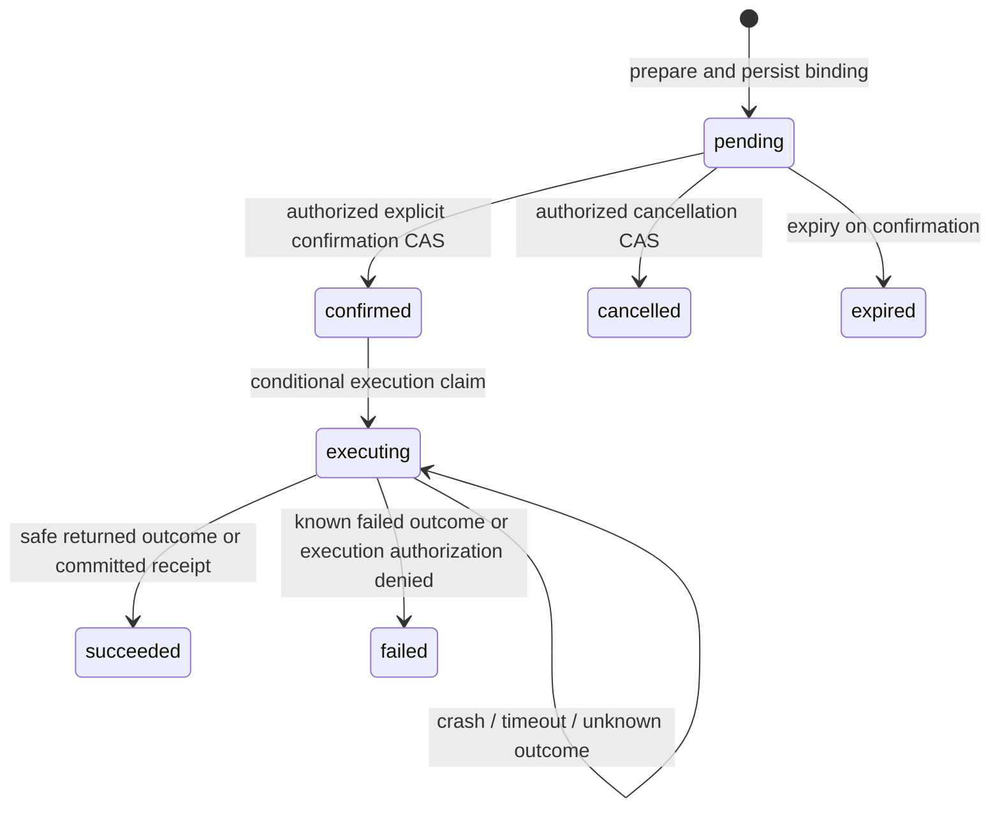

# Durable Actions T2 — review candidate, unpublished

This repository-owned API specification and runbook accompanies the code. T2
adds only `@xpell/agent/adk/actions`. It leaves the root Agent/Channel contracts,
existing `adk` factories and `adk/tools` unchanged. There is no model dispatch,
tool loop, transport route, IAM service, plugin loading or product behavior.
The already published 2.0.8 package does not contain this subpath.

## Source-backed implementation

The audited generic Starter already supplies deterministic proposal IDs,
immutable proposal hashing, actor/conversation/application checks, a 15-minute
TTL, revision and re-preparation checks, conditional state transitions and
uncertain-outcome reconciliation. T2 extracts that implementation and adds the
small public composition boundary rather than another Agent runtime or SQL
store. No product modules, records, credentials or application bindings are
extracted. The active local Starter snapshot, rather than remote Starter main,
is the source of these reviewed generic files.

`src/adk/actions.ts` validates and snapshots definitions, binds trusted contexts,
applies policy and cooperative deadlines, owns the Action profile and adapts
the generic service. `src/adk/actions/validation.ts` bounds data snapshots and
normalizes public failures. The new private Action record types select the
existing generic declarations; they do not extend Agent/Channel DTOs.

The separate `adk-action-system-xapps` bundle contains the five unchanged
generic schemas. Its app metadata and four conversation schemas match the
existing ADK bundle byte-for-byte. The existing `adk-system-xapps` bundle and
`.adk-conversations.json` marker are untouched. Reusing `composeFoundation`
loads one XNode-hosted XAgent with an inert owned mock Channel/model; none of
its chat/test-turn methods are exposed here, and ingress is denied before
model execution. No AI provider is registered. The only internal Foundation
change passes an optional existing XNode `_entity_sqlite` setting. Existing
profiles omit it and retain their prior configuration.

All Action persistence uses app-scoped EntityManager commands through
`_x.execute`, under protected `xpell-agent-starter/default`. Indexed logical
application scope and deterministic instance/actor/conversation IDs isolate
records. Context references are logical authority/audit references supplied by
trusted composition; T2 does not create conversation/message or XAuth records.
The four companion schemas are registered for profile compatibility, not as
an implicit conversation service. No direct SQL exists in the implementation;
the synthetic example/test target is a separate fixture SQLite database.

## Public API and trust boundary

```ts
import { defineAction, createDurableActions } from "@xpell/agent/adk/actions";
```

`defineAction` requires an ID, description, revision, closed input schema,
`_prepare_action` and fixed `_handler`; `_read_committed_outcome` is optional.
It reuses T1 schema validation/snapshotting and the Starter argument validator.
Only bounded string fields are accepted by the current schema contract. IDs
and schemas cannot select dynamic code, commands, providers or paths.

`createDurableActions` requires `_name`, `_instance_id`, native
`_application_scope: {_env, _app_id}`, `_host`, `_actions` and `_limits`.
`_policy` is optional and defaults to deny. `_now` is a trusted deterministic
clock seam; callers and models must never control it.

| Method | Contract |
| --- | --- |
| `start()` / `close()` | Explicit host/store lifecycle; close drains owned work and disposes providers without deleting data. |
| `bindContext({_actor_id, _conversation_id, _delivery_id})` | Trusted composition only, after start. Produces an immutable profile-bound reference; serialized, cloned and foreign references fail. |
| `prepare({_capability_id, _arguments}, context)` | Validate input, authorize, prepare the exact arguments/scope/summary, authorize that prepared scope and persist a pending proposal. Runs no effect. |
| `confirm({_action_id, _binding_hash}, context)` | Require the same actor/conversation, exact reviewed hash and a distinct delivery from the original request. Authorize current policy, re-prepare/recheck, confirm and conditionally claim execution. |
| `cancel({_action_id, _binding_hash}, context)` | Authorize the same bound caller and conditionally cancel only pending work. Cancelled replay is safe. |
| `get(id, context)` | Verify scope/binding and authorize inspection, including terminal or uncertain records. |
| `reconcile({_limit, _after_id?}, context)` | Authorize an actor/conversation-scoped scan and each evidence read. Never invokes handlers. Returns counts and an optional continuation cursor. |

The host must authenticate the actor, resolve application/conversation access,
and obtain explicit human consent before binding confirmation input. A distinct
delivery ID and proposal hash bind that consent; they do not prove identity or
human presence. `bindContext` is not an authentication or authorization service.
Do not expose it, policy callbacks or the profile object to model output or an
untrusted transport. There is no new public HTTP endpoint.

Policy phases are `prepare`, `confirm`, `execute`, `cancel`, `inspect` and
`reconcile`. Every decision must return exactly `true` to permit it. Exceptions
deny; unknown definitions fail. Policies see immutable caller context,
arguments and prepared scope when available, plus an AbortSignal. Prepared
scope wraps the definition's resource as `_resource` and includes an opaque
caller binding. Applications must inspect that resource rather than authorize
arbitrary caller claims. No policy cache/grant is persisted. A restart or
terminal replay still requires current policy. The scan-level reconciliation
decision uses capability ID `actions.reconcile`; per-row decisions use the
registered Action ID.

## Durable state and failure contract



The binding hashes capability ID/revision, exact prepared arguments/resource,
summary, requester, conversation, original delivery reference, expiry and
application scope. It detects changes; it is not a MAC or protection against
an administrator rewriting the database and hash together. Store access is
trusted. Definitions and callbacks are trusted in-process code, not a sandbox.

Confirmation rechecks the registered revision and re-prepared proposal. A
provider-atomic update matches ID, scope, binding hash and prior state; the
returned count must be 0 or 1. Only the caller winning `confirmed → executing`
can invoke the handler. Policy and expiry are checked again after that claim,
immediately before the handler. If this final check denies/throws/times out,
the handler has not run and the row becomes `failed` with a safe denial code.
There is no atomic transaction spanning remote authorization and a target;
targets must enforce their own final authority where required.

Handlers receive immutable arguments/scope, context, AbortSignal, action ID,
binding hash and stable `agent-action:<id>` idempotency key. They return
`{_status:"succeeded", _result:{...}}` or
`{_status:"failed", _failure_code:"E_REVIEWED_CODE", _result?:{...}}`.
Return `failed` only for a known outcome. Throwing, malformed output, deadline
loss, process death or completion-store failure may leave `executing` uncertain.
Application-owned result data, confirmation summaries and failure codes must
already be safe to store/disclose; do not include secrets or raw provider errors.

An `executing` or terminal replay never invokes the handler again, even when a
definition revision changes. A missing current definition fails closed. A
pending/confirmed proposal with a different revision cannot execute. A confirmed
row found after restart is not auto-run: it needs a fresh explicit authorized
`confirm` and must still satisfy expiry and exact re-preparation checks.

Reconciliation is explicit and bounded (1–100 rows, stable ID cursor). It scans
only this context's requester/conversation/application. Confirmed rows are
counted without execution; expired pending rows are materialized as expired
when confirmation is attempted. Executing rows can become terminal only from a
registered read-only callback returning matching action ID, hash, idempotency
key and a validated outcome. `null` leaves the row uncertain. Missing revisions,
denied reads or mismatched evidence fail closed. Locally active confirmations
or unsettled callbacks block reconciliation; a scan blocks new confirmations.
It never treats absence of evidence as failure or permission to resend.

Exactly-once effects in another system are **not guaranteed**. The target needs
idempotent processing and a durable receipt committed atomically with its effect.
An irreversible effect without trustworthy evidence remains uncertain for
operator resolution. The implementation neither rolls it back nor retries it.

Public `DurableActionError._code` is fixed vocabulary: `E_ADK_ACTION_` followed
by `CONFIG`, `NOT_READY`, `CLOSED`, `DENIED`, `BINDING`, `NOT_FOUND`, `CONFLICT`,
`EXPIRED`, `STATE`, `UNAVAILABLE`, `UNCERTAIN`, `RESULT`, `TIMEOUT`, `BUSY`,
`STORAGE`, `PROFILE` or `EVIDENCE`. The error message is fixed and has no raw
cause. Handler failures after the claim are reported as `UNCERTAIN`; inspect
and reconcile the stored claim. Denial at the final execution boundary is a
known no-effect failure rather than an uncertain effect.

## Activation, durability and limits

Use a new disposable folder or a matching T2 folder. A private
`.adk-actions.json` marker binds profile version, name, instance, native scope,
bundle hash and `wal-full` durability. Unknown folders, symlinks, old Conversation
profiles and changed marker values are refused without adoption/migration.
No credentials or runtime data are copied into the package.

The profile requires XNode's existing SQLite WAL/FULL mode and verifies journal,
synchronous and foreign-key pragmas. Conditional writes use SQLite's existing
operation transaction. The SIGKILL tests demonstrate process crash persistence;
they do not simulate storage-device failure or prove every filesystem's power
loss behavior. No transaction spans the Action database and a target database.
One XNode/Core host per process and one process owner per profile folder are
required. The marker is an ownership compatibility check, not an OS file lock.
No multi-process host lease or distributed reconciliation is claimed.

At most 32 definitions, 16 active operations/unsettled callbacks, 5,000ms
cooperative operation budget and 8,192 bytes per JSON object are supported.
Specify smaller budgets as appropriate. Snapshots also bound depth/nodes.
Summary length is at most 2,000 characters, input strings follow their schema,
and reconciliation pages contain at most 100 records. Callback timeouts abort
cooperatively and do not kill JavaScript or reverse effects; synchronous code
and SQLite work cannot be forcibly preempted. A callback ignoring abort remains
tracked, blocks reconciliation and can delay close. Close waits for actual
callback settlement, not merely the timeout race. No polling, worker or startup
recovery loop runs. Close is terminal; restart uses a fresh process.

## Offline runbook for review

Build/pack this branch in the normal pnpm workspace. Do not publish or change
the version. A clean consumer should install the candidate tarball and required
XNode peer, with one ESM Core/XNode engine. The optional Router peer is not
needed. Node 22 and Node 24 need their own native better-sqlite3 installation;
do not reuse/rebuild a live application's native addon. The example declares
its synthetic target dependency explicitly:

```sh
mkdir /tmp/adk-actions-review
cd /tmp/adk-actions-review
npm init -y
npm install /path/to/xpell-agent-2.0.8.tgz @xpell/node@2.0.8 better-sqlite3@12.11.1
# On npm versions requiring script approval, approve only better-sqlite3 here.
node node_modules/@xpell/agent/examples/durable-actions.mjs /tmp/adk-actions-fixture
node node_modules/@xpell/agent/examples/durable-actions.mjs /tmp/adk-actions-fixture
```

Both invocations show the same Action ID, terminal result/replay and exactly
one synthetic target row. They use only disposable local data, no credentials,
models or provider requests. This is a fixture-only consent policy; it is not
an application authentication example. Stop the profile and retain its folder
for inspection to roll back; existing profiles need no migration.

From the source workspace, run `pnpm test`. New tests execute in isolated child
processes with outbound network/provider APIs blocked and only owned ephemeral
loopback listeners. The fixture target commits a receipt in its own SQLite
transaction. Six SIGKILL boundaries cover prepared, confirmed, executing claim,
execution-policy boundary, target commit and terminal commit. Restart/replay
assert no repeated effect; target evidence can repair only the audit outcome.
Other cases cover races, policy/revision/expiry changes, unsafe input/output,
denial, mismatched receipts, scope/pagination, marker refusal and cleanup.

## Extraction provenance

SHA-256 inputs below identify reviewed generic local source, not a claim that
remote Starter main contains the owner's current working snapshot. No original
source was edited. Exact target digests and adaptations are recorded with this
candidate in the following table.

| Source | Target | Input SHA-256 | Target SHA-256 | Adaptation |
| --- | --- | --- | --- | --- |
| `server/src/actions/ActionService.ts` | `src/adk/starter/actions/ActionService.ts` | `e175e6c59cde980336e04094c9178f34f784627a7f2371bec08bbfca2d2c582a` | `9b3f3978edae8115787938d4713dc8c94cccc916b597acddabdce77b3ca3cce1` | Types import; extra execution reauthorization after the claim; uncertain completion-write errors; actor/conversation-filtered reconciliation. |
| `server/src/actions/ActionRepository.ts` | `src/adk/starter/actions/ActionRepository.ts` | `6f72cd84e2750611d1bdc5ad0b989068a7e1c0a651a4ed0ee17acdc9c4869e75` | `bf8e02d6d75f8ff196dfd8d27ef90078562bb69c163854e4880924be00f2804a` | Types import; bounded reads and actor/conversation scan filters; diagnostic object accessor. |
| `server/src/persistence/types.ts` | `src/adk/starter/actions/types.ts` | `a8e02ace2a54e97ba7eda4dcca78be9803edf7fd2ffc21d4f62f832ec1bb1cf0` | `cf2d74c21ebe9fd3ed6105ba2fb1a4d3bb4b2aca1a07a39ac4ade7d94130f74f` | Select only Action types, reusing existing AgentScopedRecord/RuntimeDate. |
| `server/src/capabilities/AgentCapability.ts` | `src/adk/starter/capabilities/AgentCapability.ts` | `35eeb950e261287bf31908fe4d67005dcaf97f90d1c716914697adad71f138b1` | `35eeb950e261287bf31908fe4d67005dcaf97f90d1c716914697adad71f138b1` | Unchanged generic contract and argument validator. |
| `server/system-xapps/xpell-agent-starter/entities/agent_action.json` | `adk-action-system-xapps/xpell-agent-starter/entities/agent_action.json` | `bb2019397b6aea8a2dda70ef9dd1b1413b3856c69f2c04878e79be1a7fc26bc4` | `bb2019397b6aea8a2dda70ef9dd1b1413b3856c69f2c04878e79be1a7fc26bc4` | Unchanged generic schema. |
| `adk-system-xapps/xpell-agent-starter/app.json` | `adk-action-system-xapps/xpell-agent-starter/app.json` | `6f057a67f99c61f42c8197948d5b0a1388cf88b9c017f3a029dd5e86a08355f8` | `6f057a67f99c61f42c8197948d5b0a1388cf88b9c017f3a029dd5e86a08355f8` | Unchanged existing ADK asset. |
| `adk-system-xapps/xpell-agent-starter/entities/channel_identity.json` | `adk-action-system-xapps/xpell-agent-starter/entities/channel_identity.json` | `2d93c61d75bab0f6f6f84409987a94a8be1c99cd1794cb3c557e72347d9cf81e` | `2d93c61d75bab0f6f6f84409987a94a8be1c99cd1794cb3c557e72347d9cf81e` | Unchanged existing ADK asset. |
| `adk-system-xapps/xpell-agent-starter/entities/conversation.json` | `adk-action-system-xapps/xpell-agent-starter/entities/conversation.json` | `dd68d019200558e8b4c186ee5939ac8d9b4696f8a8acddfcdece181655e6c9c1` | `dd68d019200558e8b4c186ee5939ac8d9b4696f8a8acddfcdece181655e6c9c1` | Unchanged existing ADK asset. |
| `adk-system-xapps/xpell-agent-starter/entities/conversation_participant.json` | `adk-action-system-xapps/xpell-agent-starter/entities/conversation_participant.json` | `99e9093614ae77e0c716261c9a4cbcea285939bf47862bb262a9c5be5e50abe9` | `99e9093614ae77e0c716261c9a4cbcea285939bf47862bb262a9c5be5e50abe9` | Unchanged existing ADK asset. |
| `adk-system-xapps/xpell-agent-starter/entities/message.json` | `adk-action-system-xapps/xpell-agent-starter/entities/message.json` | `01c8088ba1c9786ea1261326c4b7a0020ec611c40b55a7bcc65abc5653fa80b2` | `01c8088ba1c9786ea1261326c4b7a0020ec611c40b55a7bcc65abc5653fa80b2` | Unchanged existing ADK asset. |

The existing generic actor, deterministic key and application-scope helpers are
reused from the already extracted ADK modules. No product source is imported.
Future model loops, plugins, IAM or product migration require their own design
and approval; they are not enabled by these definitions or profile.
